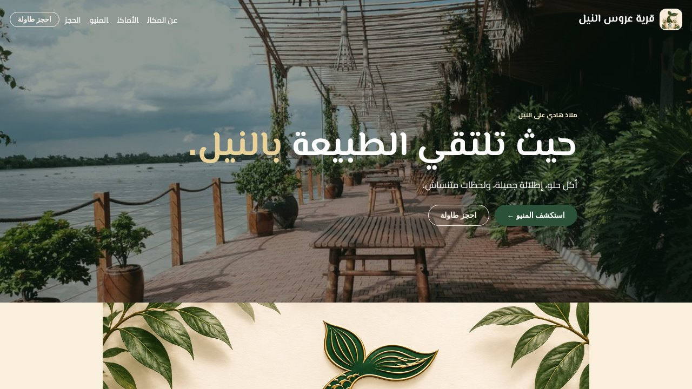

# قرية عروس النيل - Cafe App

موقع وتطبيق لكافيه «قرية عروس النيل» بالعربي (RTL)، بيتفتح من الموبايل ويتثبت زي أي أبلكيشن.

**الموقع اللايف:** https://mhmd7710d.github.io/cafe-app/



## فيه إيه
- **الأماكن:** ٨ مناطق (صالة شباب ١ و٢، منطقة أطفال، عائلات، VIP، قاعة مناسبات، مكان تصوير، مطعم)، وكارت لكل واحدة.
- **المنيو:** مشروبات وأكل، بصور وأسعار.
- **قاعة المناسبات:** ألبوم صور للقاعة (تجهيز الكراسي والممرات، والخلفيات والمنصات).
- **الحجز:** فورم حجز (اليوم، الساعة، عدد الأفراد، رقم الموبايل). واجهة بس لحد ما يتم ربطه بواتساب أو باك إند.
- **يتثبت على الموبايل:** PWA، يفتح من الشاشة الرئيسية ويشتغل أوفلاين.

## التقنيات
React 19 + Vite، CSS عادي بمتغيرات، PWA (manifest + service worker)، والنشر على GitHub Pages عن طريق GitHub Actions (أي push على `main` بينشر لوحده).

## تشغيل محلي
```
npm install
npm run dev     # نسخة التطوير
npm run build   # نسخة الإنتاج في dist/
```

## شرح الكود جزء جزء
[EXPLAINED.md](EXPLAINED.md) فيه شرح كل ملف وكل جزء خطوة بخطوة، مفيد لو حد سأل عن المشروع في انترفيو.

## الصور والحقوق
صور الأماكن صور ستوك مؤقتة لحد ما تيجي صور المكان الحقيقية، وصور الأكل في المنيو رسومات توضيحية. المصادر والتراخيص في [CREDITS.md](CREDITS.md).
اللوجو ملف صاحب المكان الأصلي زي ما هو (`brand/logo-original.jpg`)، والموقع بيعرض `public/brand/logo.jpg` بنفس البايتات.
الخطوط: El Messiri للعناوين و Cairo للنصوص، مستضافة مع الموقع نفسه.

## ملاحظة
المنيو والأسعار مبدئية لحد ما تتأكد من صاحب المكان.

## English
Mobile-first Arabic cafe site and installable app: 8 seating areas, a photo menu, an event-hall photo album, and a booking form (interface only). React 19 + Vite, plain CSS, PWA, deployed to GitHub Pages by GitHub Actions. Menu and prices are still placeholders.

Built by [Mohammad Fathi](https://github.com/mhmd7710d).
